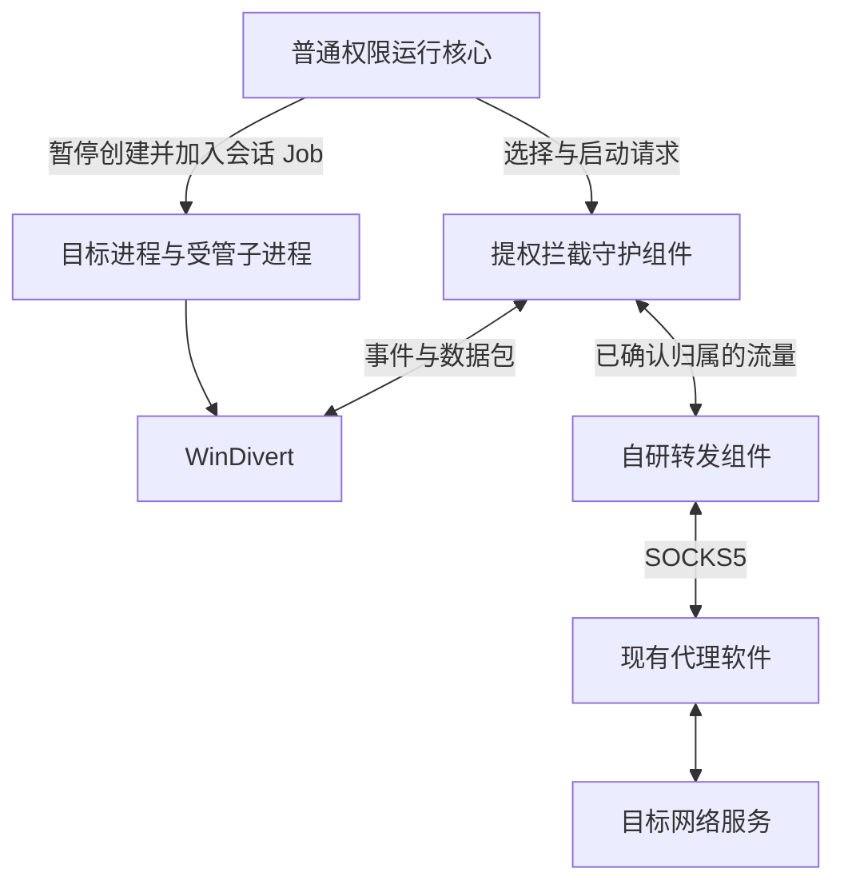

# 辅助启动器逻辑实现方案

依据[核心需求](../requirements/辅助启动器核心需求.md)、[痛点文档](../requirements/辅助启动器痛点文档.md)和[UI 状态定义](辅助启动器UI实现文档.html)，采用现成已签名 WinDivert 驱动作为网络基础设施，进程管理、流量归属及代理转发均由本项目自研。

方案的执行主线为：恢复程序与代理入口，取得网络接管权限，受控创建普通权限目标，确认会话绑定后放行，持续处理受管进程树的连接，最后按会话回收。

实现以真实软件可用、减少重复操作和不误伤其他程序为原则。已确认受管流量转发失败时不主动改为直连；极少数无法确认归属的数据包按原路径放行并记录。拦截保护中断时保留目标软件、如实告警并尝试恢复，不承诺故障期间持续阻断。

## 整体架构与职责

| 模块 | 权限与运行边界 | 权威状态与职责 |
| --- | --- | --- |
| 启动器运行核心 | 原始交互用户的普通权限进程 | 程序记忆、目标选择、启动请求；创建普通权限目标，向调用方输出统一状态。 |
| 拦截守护组件 | 经 UAC 启动的管理员权限进程 | 持有 WinDivert 句柄和会话 Job；维护进程身份、端点与数据包归属，执行转发或阻断决定。 |
| 自研转发组件 | 普通权限独立进程，位于目标 Job 之外 | TCP 本地中继、SOCKS5 握手、UDP 中继关联及明确归属的 DNS 转发；维护实际传输连接。 |
| 现有代理软件 | 独立运行的 V2Ray、Clash 等软件 | 提供本地 SOCKS5 入口及既有出口、路由；其节点、连接和生命周期不由本项目管理。 |
| WinDivert | 采用固定版本的已签名发行包 | 提供底层事件和数据包捕获、阻断及重注入能力。 |

转发组件单独运行，是为了使协议处理异常不会直接关闭拦截句柄。它不拥有受管进程范围，也不能要求守护组件把失败流量改为直连。

同一用户登录会话只由一个普通运行核心维护记忆和启动入口，重复打开连接既有实例。提权使用另一管理员账户时，仍使用原交互用户的记忆和目标环境。

程序记忆由普通核心管理；活动会话由守护组件确认接管后管理；传输连接由转发组件管理。跨组件传递命令与事实，不维护多份可以分别修改的会话主状态。所有异步消息带会话标识、请求标识及状态版本，过期消息不能改变下一次启动。

普通核心保留故障恢复所需的 Job、进程引用及会话身份，但不据此维护第二套流量决策。守护组件重新就绪后，以存活进程核对原会话，而不是另建一个重复运行的目标。

组件间使用限于本次用户与会话的本地 IPC，核对用户身份、登录会话和对端进程。提权组件只接受规定的接管命令，不作为执行任意管理员命令的通道。程序组件与驱动库从确定的安装位置加载，不能由目标程序决定其加载路径。

## 本地代理入口

对所有代理软件使用同一种连接描述：本机地址、端口、可选认证、配置版本以及所需 TCP/UDP 能力。不按软件品牌区分后续转发流程。

### 一次保存与长期复用

- 允许用户保存一个本地 SOCKS5 入口，后续打开和启动默认复用，不要求每次输入。
- 入口与程序历史由同一普通运行核心按用户保存；必要认证信息安全保存，不写入明文日志。
- 已保存入口不可用时报告连接问题或等待它恢复，不自动改用其他端口。
- 每个活动会话固定入口及配置版本；修改保存值供后续会话使用，不悄悄改变正在运行的软件出口。

### 未配置时的辅助探测

仅在没有保存入口时，探测少量常见的本机回环地址与候选端口。探测使用短超时，不扫描局域网或全部端口，也不修改现有代理软件配置。

端口可连接不等于 SOCKS5 可用，必须完成协议核对。只有一个明确可用、认证及必要能力已确认的候选入口时，才自动采用并保存；没有明确结果、存在多个候选或还需要认证信息时，提示用户确认或补充。

用户确认、手工输入和辅助探测得到的入口，都进入同一个验证与保存流程。一次确认后长期复用，不在每次启动时重复探测。

### 可用性判断

- SOCKS5 协商和认证通过，才认为本地入口可用。
- 需要 UDP 时核对关联建立及实际数据往返，不能只凭 TCP 端口可连判断 UDP 也可用。
- 单个远端目标失败只结束该连接；入口或必要转发通路不可用才进入 PROXY_LOST。
- 入口检测成功与真实软件业务成功分别记录，不相互代替。

## 提权与普通权限启动时序

### 权限模型

普通核心以当前交互用户的非提升令牌运行，只有守护组件通过 ShellExecuteEx 的 runas 动作请求 UAC。即使 UAC 使用了另一个管理员账户，目标仍由原普通核心创建，不使用管理员账户的环境、配置目录或令牌。[Windows 提权启动说明](https://learn.microsoft.com/en-us/windows/win32/api/shellapi/ns-shellapi-shellexecuteinfow)

目标从创建时就是普通权限；管理员组件随后操作进程句柄或恢复主线程，不改变其令牌。首版若发现启动器本身已被提升，则拒绝直接创建目标并要求普通方式启动；需要提升权限才能运行的目标也不自动提权。

### 启动事务

1. **接收启动请求。** 普通核心检查没有活动会话，固定目标路径并进入 PREPARING；后续选择、移除和重复启动请求直接拒绝。
2. **确定入口并验证环境。** 复用已保存入口；未配置时执行辅助探测及必要的用户确认，然后固定本次代理描述。重新检查目标文件、本地代理能力、组件文件与驱动发行包。入口尚未确定时不创建目标；验证失败保留程序记忆和已保存配置。
3. **请求 UAC。** 启动或连接已认证的守护组件。拒绝授权时结束事务，不启动目标。
4. **准备捕获与转发。** 守护组件先建立 SOCKET/FLOW 观察、进程生命周期观察和既有连接基线，再启用 NETWORK 数据包截获；普通核心启动转发组件，后者登记中继端点和上游连接豁免范围。
5. **准备会话 Job。** 建立专属 Job 及其通知通道，明确禁止受管进程脱离会话的默认策略；不启用控制方关句柄就杀死全部目标的默认行为。
6. **暂停创建目标。** 普通核心以自己的普通用户令牌使用 CREATE_SUSPENDED 创建 exe，在主线程放行前将其加入 Job；工作目录默认为 exe 所在目录。加入 Job 失败即回滚。
7. **转交会话所有权。** 通过受限句柄传递把 Job、目标进程及主线程交给守护组件。守护组件验证 PID、创建身份、用户、权限和 Job 归属，并提交根进程记录。
8. **确认接管就绪。** 守护组件确认捕获、归属表、转发入口和保护状态均可用，返回带会话标识的就绪回执。
9. **提交放行。** 普通核心提交一次性的放行命令，由守护组件恢复目标主线程并记录结果。重复提交返回同一结果，不能重复创建程序。
10. **报告运行。** 获得放行成功及保护有效的事实后进入 RUNNING。程序业务可用性仍由实际连接和业务结果确认。

普通核心在提交放行前失联，守护组件回滚已接收的暂停进程；在放行后失联，守护组件继续拥有会话并维持接管。通过把放行操作交给会话所有者，避免“调用方不知主线程是否已恢复”导致重复启动。

若启动失败，只有确认暂停目标及本事务资源回收完毕，才能报告 FAILED 并解锁。回收未完成时继续保留准备事务及失败原因，不能伪装成可立即重试的状态。

## 进程树与连接归属

### 进程身份

每次启动生成唯一 SessionId。每个进程用 ProcessKey 表示，至少包括 PID 与系统创建身份，并保留必要的进程句柄；不能用文件名、路径或单独的 PID 作为会话成员判断依据。

Job 是本次运行范围的重要事实来源。正常继承该 Job 的子孙进程属于会话，用户另外打开的同名实例不属于会话。守护组件处理新的 Socket 事件时，直接核对该进程实例与 Job 的关系；不等待定时扫描先把子进程加入列表。

生命周期跟踪以 Job 完成端口通知、已持有进程句柄的退出通知和成员复核为主，进程启动/退出事件用于辅助更新记录。Job 通知并非全部保证送达，不能只凭一条通知判断整个进程树已结束。[Job 生命周期说明](https://learn.microsoft.com/en-us/windows/win32/procthread/job-objects)

需要脱离 Job、由共享服务或已有实例代发工作的程序，不自动扩大为系统进程接管。无法保持归属关系时，该运行方式不在首版支持范围。

### WinDivert 分层使用

| 层 | 使用方式 | 在本方案中的用途 |
| --- | --- | --- |
| SOCKET | 观察模式读取绑定、连接和关闭等事件 | 建立端点与进程实例的关联，识别新端点。 |
| FLOW | 观察已建立及删除事件 | 补充五元组、端点生命周期和归属核对。 |
| NETWORK | 实际截获相关数据包，按判定重注入或阻断 | 暂存待归属首包、TCP 引流与逆向映射、UDP 返回注入。 |

NETWORK 数据包没有 PID；SOCKET/FLOW 提供进程信息但能力不同。SOCKET 不能作为“暂扣事件、稍后重注入放行”的接口，FLOW 也不是第一包之前的同步关卡。[WinDivert 分层能力](https://reqrypt.org/windivert-doc.html#divert_layer)

Socket 的 ParentEndpointId 表示端点关系，不能当作父进程 PID。进程树来自进程与 Job 生命周期事实。

### 端点与数据包关联

守护组件维护两类关联：

- **端点记录**：地址族、协议、EndpointId 及其代次、ProcessKey、本地地址与端口、生命周期。
- **流记录**：原始五元组、所属端点与会话、创建代次、转发映射和当前处置。

NETWORK 数据包先查询流记录，再结合 SOCKET/FLOW 事件匹配端点。GetExtendedTcpTable/GetExtendedUdpTable 的所有者信息只作补充核对；尤其 UDP 所有者表主要提供本地绑定信息，不能独自证明每个远端数据报的唯一归属。[UDP 所有者表说明](https://learn.microsoft.com/en-us/windows/win32/api/udpmib/ns-udpmib-mib_udprow_owner_pid)

事件可能延迟或乱序。时间戳先统一计时基准，再结合端点代次与进程创建身份判断；时间接近不能替代身份。进程退出或 Socket 关闭后保留必要的关闭期记录，旧事件不得绑定到复用同一 PID、端口或五元组的新连接。

未建立映射的首包先在 NETWORK 截获路径中作短时间、有上限的归属核对；能够确认时按归属处理，极少数超时未确认的包按下节规则原样放行。SYN 重传合并到同一待处理连接，UDP 保持报文边界。

### 归属不明时优先不误伤

数据包按已有证据分为三类：

1. 已确认属于会话：按正常转发或本会话的失败阻断策略处理。
2. 已确认不属于会话：原样放行。
3. 暂时无法确认：短时间等待事件补齐及端点核对；超时仍不明确时，原样重注入并记录原因，不因归属未知而主动丢包。

等待队列必须有容量与期限。未知候选包遇到等待队列已满时，同样优先原样放行，不能通过无限等待或全局丢包保护某个会话。

放行结果标记为 UnknownBypass，不将它伪装成已经确认的非成员，更不能计入代理成功。日志只记录必要的时间、连接信息、原因和计数，不记录业务负载或认证信息；按流合并和限频，避免逐包日志影响正常使用。

为避免中途换路破坏连接，首包已原样放行的 TCP 连接或 UDP 流保持原路径至该流结束；后续新流重新判断。后来确认它属于目标程序时，也应记录为未覆盖连接，不能把已有连接强行搬到代理上。一例超时不能扩大成某个程序或端口的长期直连白名单。

此规则仅适用于尚未确认归属的原始候选包。已经确认受管的流量、内部中继返回和已知转发失败报文，不能被重新标成未知来放行。

未知放行意味着少量目标流量可能未经过代理，不能宣称全流量防漏。它是为了不误伤其他软件而采用的明确取舍。若未知放行持续增加或已确认影响目标程序的代理覆盖，合并提示并改进归属处理，不以放行数量增长掩盖实现问题。

候选捕获范围可能比受管集合更宽，因此仍需检查无关软件的延迟和丢包。正常业务可用与实际经代理转发应分别验证。

### 回环与自身连接

处理顺序必须区分两种本机数据包：

- 属于已登记 TCP 中继映射的返回包，先执行逆向映射。
- 其他本机回环通信保持原样，不送往远端代理。

转发组件的 SOCKS5 上游连接、控制 IPC 连接及现有代理软件自身的出口连接，不再次纳入会话转发。豁免以实际进程实例、端点和用途判定，不能只凭程序名或一个宽泛端口规则。

守护组件掌握每次重注入的来源与映射，设置清晰的句柄优先级和捕获范围，避免重复捕获形成回环。与其他网络过滤组件的共存必须验证，不卸载他人的驱动或规则。

## TCP、UDP 与 DNS 转发

### TCP

采用自研 NAT 引流加本机 TCP 中继，利用 Windows Socket 栈处理 TCP 可靠传输；中继与现有代理之间使用自研 SOCKS5 客户端。

1. 截获并确认归属的首个 SYN，建立 FlowId、原始五元组与独立中继映射。
2. 转发组件先连接 SOCKS5 入口，完成认证和针对原始目标的 CONNECT；此时原 SYN 仍未发往真实目标。
3. 上游成功后，复核原端点仍存活、代次相同且请求未取消，再把保留的 SYN 按映射交给本机中继端点，使目标程序完成自己的 TCP 连接；过期握手结果不能重新激活旧连接。
4. 应用方向的数据包映射到中继，中继读取应用字节并发送到 SOCKS5 连接；代理返回的字节通过中继发送，并由守护组件逆向映射为原始对端返回。
5. 上游建立失败或超时，按已验证的 TCP 失败语义结束该次连接，不发送保留的原始 SYN 到真实目标。

这样，连上本机监听端口不能被提前当作远端连接已成功。中继映射由控制通道传递，不能把内部识别头混入应用数据。并发连接使用唯一中继关联，不能只用源端口查原目标。

映射需要正确处理地址族、TCP 标志、重传、半关闭、RST、校验和及连接复用；映射保持到连接实际结束，不能仅因空闲时间达到固定值就删除仍存活 TCP 的归属。具体包地址与方向的变换须先在目标 Windows 版本上验证。

首版不实现自己的完整 TCP 协议栈。TCP Fast Open、特殊绑定、额外包选项或网络安全策略导致本机引流不兼容时，不能用直接连接降级掩盖失败。

### UDP

UDP 使用自研数据报转发，不把原数据包直接发向真实目标。

1. 确认进程、端点及目标归属，为受管 UDP 端点建立 SOCKS5 UDP ASSOCIATE，并保留控制连接。
2. 把原始目的地址、端口与应用数据封装成 SOCKS5 UDP 数据报，经转发组件自己的 Socket 发往代理返回的中继地址。
3. 收到中继响应后验证来源、关联与仍存活的原应用端点，解封装原始来源和数据，构造返回原应用端点的数据包，由守护组件注入；已结束端点的响应直接丢弃。
4. 控制连接断开即终止该关联；恢复后使用新的关联代次，旧关联的迟到响应不得进入新会话。

中继地址来自协议响应，不能假定与 SOCKS5 TCP 入口相同。应用可用 connected UDP 或非连接 UDP；处理依据是明确的端点与每个数据报目标，不依赖其采用哪一个发送 API。[SOCKS5 连接与 UDP 关联规则](https://www.rfc-editor.org/rfc/rfc1928)

保持数据报边界、零长度负载和长度上限，计入封装增加的开销。首版先验收无 IP 分片的单播 UDP。对于已经确认受管的分片或不支持形式，明确按该连接失败处理；对于原始归属始终未知的包，使用 UnknownBypass 规则，不扩大阻断范围。

还需处理与受管流量相关的 ICMP/ICMPv6 差错，避免内核把注入响应的错误信息直接发向原始远端。只处理可确认关联的差错，不能阻断无关的邻居发现、路径探测或其他系统通信。

### DNS

DNS 采用按已确认流量归属的透明转发，按来源分为三类：

| 查询来源 | 处理策略 |
| --- | --- |
| 目标进程自己发出的 UDP/TCP DNS | 使用对应 UDP 或 TCP 转发链，经 SOCKS5 发送；TCP DNS 的长度前缀与报文内容原样保留。 |
| 目标进程自己发出的 DoH、DoT 或基于 UDP 的加密解析 | 作为普通 TCP/UDP 连接转发，不解密 DNS 内容；仍受相同归属和协议能力限制。 |
| Windows 共享 DNS Client 服务代发 | 不把服务 PID 加入会话，不接管它的全部流量；按下述边界处理。 |

已归属的普通 DNS 默认发向原查询指定的解析器。如果它是仅本地网络可达的解析器，可使用明确的会话解析器配置，通过 SOCKS5 向替代解析器转发，并在返回方向保持应用所见的原查询端点。该配置仅作用于已确认属于会话的查询，不修改系统 DNS，也不静默指定公共解析器。

DNS 响应与端点、远端和查询实例关联；并发重复查询、响应迟到及 UDP 转 TCP 不得串线。不伪造“成功解析”掩盖代理失败，不把 SOCKS5 的域名目标功能当作独立 DNS 解析服务。

### 共享 DNS Client 服务的阶段安排

Windows 可以把应用的解析交给共享 DNS Client 服务，结果也可能来自共享缓存。[Windows DNS 查询流程](https://learn.microsoft.com/en-us/windows-server/networking/dns/queries-lookups)

服务发出的查询不能仅凭域名或时间接近就可靠归属于目标程序；多个应用也可能共同等待一次查询。首阶段保持这部分解析的系统原路径，不接管全部 DNS 服务流量，也不修改全局 DNS。

先完成 TCP、UDP 和目标程序自主 DNS 的真实转发，再使用真实目标软件验证。不因软件使用系统共享 DNS 就预先排除它；若现有系统解析已能满足业务，它仍可通过后续 TCP/UDP 转发正常使用，但不能把共享 DNS 宣称为已代理。

如果实测表明共享 DNS 造成解析失败、返回错误结果或阻塞关键业务，应记录具体程序、查询和表现，在下一阶段专门解决。共享 DNS 是持续完善的能力，不是永久放弃项。

后续改进仍遵守会话隔离和不改全局 DNS 的原则。诊断信息用于定位和验证归属，不以猜测关联或代理整个系统 DNS 服务代替问题解决。

## 程序记忆

每个用户保存一份版本化设置快照，程序记忆与已保存的代理入口分字段管理。程序记忆包括最多 4 项近期程序及当前选中引用。程序名由路径派生，文件是否仍存在由实时检查决定，不把检查结果当作永久状态。

- 新选 exe 通过校验后提交选择、去重并移到首位；取消或选择无效的新文件不替换原选择。
- 选择已有历史记录时更新当前引用并检查文件；若路径失效，进入 MISSING 并保留该记录，不能仍显示另一个目标为本次选择。这与 UI 状态定义一致。
- 自动恢复不启动程序、不改变顺序；没有当前选择时保持 IDLE。
- 移除非当前项不改变当前选择；移除当前项同时清空选择，不自动改选。全部清除后回到首次使用状态。
- 文件路径按 Windows 路径规则规范化；同名不同路径不合并。运行期间路径失效不等于进程已退出。
- 选择、移除和容量淘汰作为一次快照更新，串行保存到同目录临时文件并原子替换正式文件。
- 保存失败保留内存选择并报告未保存，后续保存最新快照；损坏数据先保留，未知格式不直接覆盖。

代理入口保存失败同样单独报告；本次已验证的内存配置可以继续使用，但不能把它表述为下次已能自动恢复。

记忆只能决定待启动目标。活动目标始终取自守护组件持有的会话快照，不能从历史首项或磁盘文件反推。

## 会话状态机与状态输出

状态输出不包含颜色、尺寸或控件实现。正常启动、运行、代理中断和回收沿用既定状态语义；拦截组件异常单独使用保护中断告警，不能与“代理不可用但阻断有效”混用。

| 状态 | 进入条件 | 操作边界 |
| --- | --- | --- |
| IDLE | 无当前选择且无活动会话 | 可选择或切换历史，不可启动。 |
| READY | 当前记录存在、文件可用且无活动会话 | 可选择、移除和请求启动；不表示代理已经验证。 |
| MISSING | 当前选择的文件不可用且无活动会话 | 可重新选择、切换或移除，不可启动。 |
| PREPARING | 启动事务开始，直到放行成功或回滚完成 | 锁定目标变更、历史变更和重复启动。 |
| RUNNING | 目标已放行，接管及转发通路有效，仍有受管进程 | 保持锁定。 |
| PROXY_LOST | 受管进程仍存活，转发通路不可用，已确认受管连接的阻断仍有效 | 保留进程和锁定，已确认受管流量不回退直连；未知包仍按 UnknownBypass 规则处理。 |
| PROTECTION_INTERRUPTED | 运行中的拦截保护发生中断，当前会话的完整覆盖不可确认 | 保留目标进程及锁定，明确告警并尝试恢复；不显示“已阻止直连”。 |
| RECOVERING | 所有受管进程已退出，正在释放会话资源 | 保持锁定直到回收完成。 |
| FAILED | 启动未成功，且本次创建的进程和临时资源已确认回滚 | 保留有效选择，可更换或重试。 |

主要状态迁移：

- IDLE、READY、MISSING、FAILED 根据选择与文件检查互相转换；只有有效目标能发起启动。
- READY 或 FAILED 接收启动后进入 PREPARING，成功转为 RUNNING，完成回滚后转为 FAILED；目标文件失效则在清理后进入 MISSING。
- RUNNING 与 PROXY_LOST 根据实际转发通路变化转换，目标与进程集合保持同一会话。
- RUNNING 或 PROXY_LOST 发生拦截保护异常时进入 PROTECTION_INTERRUPTED，保留会话与目标进程。
- RUNNING、PROXY_LOST 或 PROTECTION_INTERRUPTED 在所有受管进程退出后进入 RECOVERING，完成后按保留文件的实际状态进入 READY 或 MISSING；无选择则进入 IDLE。
- 父进程退出、关窗或单个连接失败都不能自行触发会话结束。

PROXY_LOST 恢复为 RUNNING 前，必须同时确认代理入口、所需转发能力和拦截保护仍有效。已断开的 TCP 连接不自动续传；新的请求重新建立代理连接。UDP 重新建立关联，不重放已经过期的数据报或应用业务。

本地代理中断期间，已经确认受管的外连按协议失败或丢弃，不积压应用负载等待恢复；归属未知流量仍遵循不误伤原则。恢复只允许后来新发起的请求重新进入转发链。

保护中断后即使组件恢复，也不能推定其间已经形成的连接都受控。恢复后只接管新建立且归属明确的连接，现有连接不强行迁移，告警保留至用户自行结束并重新启动目标会话。

运行核心拒绝忙碌期间的目标变更，不把这些命令排队到解锁后补执行。状态消息携带实际失败原因和资源回收结果，不能只返回一个笼统成功标记。

## 异常、保护与回收

### 常见异常

| 异常 | 处理 |
| --- | --- |
| UAC 拒绝、驱动加载或捕获初始化失败 | 不放行目标；回滚完成后 FAILED，保留选择。 |
| 目标要求管理员权限、创建失败或 Job 绑定失败 | 明确失败，不改用管理员令牌重新启动；清理本次暂停进程。 |
| SOCKS5 握手失败或启动前 UDP 能力不满足 | PREPARING 内回滚，完成后 FAILED。 |
| 运行期本地代理失联 | 守护组件继续工作，已确认受管外连失败或丢弃；进入 PROXY_LOST，不终止目标。 |
| 转发组件崩溃 | 守护组件保留捕获和归属，阻止已确认受管流量直连并重启转发组件；只有保护有效时才按转发通路中断报告。 |
| 拦截守护组件崩溃 | 进入 PROTECTION_INTERRUPTED，保留目标程序，提示“保护中断，建议重启目标软件”，并尝试恢复。 |
| 普通运行核心异常退出 | 守护组件继续管理已提交会话；核心重启后认证并重新附着，不创建第二个会话。 |
| 单个远端目标失败 | 结束该连接并报告具体原因，不错误地把整个本地代理标记为不可用。 |
| 父进程先退出 | 受管子进程继续由同一 Job 和会话维护，状态仍为 RUNNING 或 PROXY_LOST。 |
| 清理失败 | 保持 RECOVERING 与锁定，记录未完成资源；不返回 READY。 |

运行中的关窗只结束可见交互，核心与会话继续存活。退出意图不等于终止目标，也不等于关闭拦截。

### 拦截守护组件自身异常

普通运行核心发现守护组件退出、失联或捕获能力失效时，立即进入 PROTECTION_INTERRUPTED，并给出明确提示：**保护中断，建议重启目标软件。**

处理遵循以下规则：

1. 绝不强杀、自动重启或要求用户立即关闭正在运行的目标软件；由用户自行决定何时保存工作并重启。
2. 不报告“已阻止直连”，不把故障误报成已完成回滚的 FAILED；明确保护中断期间可能存在未受控流量。
3. 保留会话和进程身份，继续锁定重复启动与目标变更。普通运行核心保留必要的 Job 和进程引用，以便组件恢复后重新关联。
4. 有界重试恢复守护组件。若需要重新 UAC 授权，明确请求一次；用户取消后保持告警，不反复弹窗，也不终止目标。
5. 组件恢复后核对原会话、存活进程和捕获通路，只对新建立且可确认归属的连接恢复代理。不强行迁移已有连接，不自动重放应用业务。
6. 当前会话保留中断告警；若组件已恢复，可提示“新连接已恢复接管，建议保存后重启目标软件”。用户自行结束目标、正常回收并重新启动后，才按新会话状态判断保护。

WinDivert 的公开实现在句柄清理时存在重注入尚未超时队列包并移除过滤的路径。因此，本方案不把组件崩溃后的保护保证写成“始终阻断”，也不以强杀目标软件换取这一保证。[WinDivert 句柄清理实现](https://github.com/basil00/WinDivert/blob/master/sys/windivert.c)

验收重点是目标软件与未保存工作不被本项目主动终止、告警真实、恢复尝试可见，而不是把异常退出包装成没有保护间断。

### 正常回收顺序

1. 核对 Job 实际成员、已登记进程句柄与待处理的成员事件，确认没有受管进程或待提交启动；同时保留尚未结束端点的关闭期归属，不能仅因进程退出就立即删除全部流映射。
2. 进入 RECOVERING，停止接受本会话新转发工作，取消未完成握手和解析转发。
3. 关闭本会话上游 TCP 与 UDP 控制连接，处理必要的 TCP 关闭和返回映射，防止迟到包进入新会话。
4. 在拦截组件仍存活时处理用户态及驱动中的待处理数据包：已确认受管残留不得直接重注入外部目标，无关原始包原样放行；超时仍未知的原始候选包按 UnknownBypass 规则放行并记录，内部中继残留不能混入该例外。
5. 完成接收停止与队列排空后再关闭本会话句柄，不能把 WinDivertClose 当作“全部丢弃队列”的操作。此时不存在仍依赖这些句柄保护的目标进程。
6. 释放中继映射、端点及进程引用、IPC 和 Job，确认资源清单归零。
7. 保存最新程序记忆，重新检查保留目标，返回对应空闲状态。

异常代理中断期间不执行正常关闭句柄流程。只关闭本项目拥有的句柄和连接，不全局卸载共享 WinDivert 驱动，不停止现有代理软件，也不改写原有网络配置。

## 首版范围与能力边界

首版以 Windows 10/11 x64 主机上的普通交互式 Win32 客户端为目标，目标程序可为 x86 或 x64；支持声明以所选驱动版本及实际验证的系统版本为准。

| 场景 | 首版边界 |
| --- | --- |
| 本次创建并保持在会话 Job 内的进程树 | 目标范围，需通过首包、子进程和 PID/端点复用验收。 |
| 唯一可归属的 TCP、UDP 单播 | 目标能力；IPv4、IPv6 分别验证，不能通过放行未处理地址族降级。 |
| 受管进程自行发送的 DNS | 使用明确的 TCP/UDP 转发，支持 UDP 转 TCP 等真实查询行为。 |
| 共享 DNS 服务代发 | 首阶段保持原系统解析路径，以真实软件是否可用判断后续工作；实测阻塞关键业务时进入下一阶段专项解决。 |
| 共享 UDP 端口、无法唯一关联的片段或短命进程竞争 | 短时核对后仍未知的原始包原样放行并记录；不猜测归属、不误阻断其他程序，也不计入代理覆盖。 |
| 已有实例、服务、broker 或脱离会话 Job 的工作进程 | 不自动接管，也不根据同名路径扩展范围。 |
| 必须提升权限的目标、无法保持 Job 约束的程序 | 普通权限首版不支持，明确返回原因。 |
| 公网入站服务、广播、多播、任意 IP 协议 | 不纳入 SOCKS5 客户端转发能力；必要的系统本机通信原样保持。 |
| WinDivert 被系统策略禁止、与其他过滤组件冲突 | 明确不可用，不通过关闭系统保护或卸载他人的组件绕过。 |

应用类别不直接决定兼容性。浏览器、聊天软件和游戏都须检查实际进程结构、解析路径和通信方式。对一个具体程序的有限成功不能推广成全部程序、全部协议或全部系统版本都支持。

## 分阶段验收

| 阶段 | 验证内容 | 通过标准 |
| --- | --- | --- |
| 权限与启动事务 | 正常 UAC、取消、不同管理员账户授权、驱动失败、目标创建和 Job 失败 | 目标令牌保持原普通用户身份；未就绪不放行；回滚后无本次暂停进程或资源残留。 |
| 归属与首包 | 父子孙并发、父退子存、同名外部实例、PID/端口复用、短命进程、乱序事件 | 已确认受管流量按代理策略处理，非成员不误伤；未知超时按规则原样放行并有日志，不能被计入代理成功。 |
| TCP | 并发连接、SYN 重传、拒绝、超时、半关闭、大传输、IPv4/IPv6 | 业务字节正确，中继与原目标一致，无代理回环，无提前报告远端连接成功。 |
| UDP 与 DNS | connected/非 connected UDP、多目标、关联重建、长度边界、自行解析与共享解析分别测试 | 数据报与响应不串线，自主 DNS 真实经代理；共享 DNS 保持原路径，发现实际阻塞时留下下一阶段的问题记录。 |
| 代理中断恢复 | 运行中关闭及恢复本地代理；分别验证 TCP 与 UDP | 目标进程保留，已确认受管连接不主动回退直连；恢复后新请求成功，不重放旧业务。 |
| 组件故障与回收 | 普通核心崩溃、转发组件崩溃、拦截组件崩溃、队列压力、清理重试 | 不强杀正在运行的目标；保护中断明确告警并尝试恢复，不虚报阻断；正常清理不释放已确认受管残留，不主动丢弃未知包误伤其他程序。 |
| 真实软件 | 至少一款实际目标软件的关键业务，并在两种主流代理软件的 SOCKS5 入口上复测 | TUN 关闭、全局配置不变，关键业务完成；同时存在的非受管同名实例保持原路径。 |

验证须同时观察应用结果、实际代理路径、未知放行记录及对其他软件的影响。程序能联网但关键连接实际直通，不能算代理功能通过。第一阶段先跑通一款真实目标软件；其他软件和第二种代理入口随业务验证逐步扩展，不提前堆叠全部兼容场景。

## 第一阶段开工计划

第一阶段交付一个能实际经代理启动程序的本地版本，以及对应源码和简短验证记录。以一款真实目标软件的关键业务跑通为首要目标。

1. **做好入口和记忆。** 按现有设计完成选择程序、恢复上次选择、切换和移除历史、文件失效提示；代理入口保存一次，未配置时辅助探测，无法唯一确定时请用户确认。
2. **打通真实启动。** 只为网络接管请求管理员权限，目标程序保持普通权限；接管准备好再启动，失败明确提示并保留原选择。
3. **跑通实际联网。** 先完成 TCP，再完成 UDP 和软件自主 DNS 转发，连接用户现有的本地代理。无法确认归属的少量包按规则放行并记录。
4. **验证真实使用。** 关闭 TUN，用选定软件完成真实关键业务，同时确认其他正常软件不受影响。共享 DNS 若阻塞使用，记录具体问题并列为下一阶段重点，不永久排除这类软件。
5. **补齐掉线和异常体验。** 验证代理断开后保留目标、恢复后新请求继续代理；拦截组件崩溃时明确告警、不强杀目标并尝试恢复；目标及其子进程全部退出后，只清理本会话资源。

第一阶段的完成依据是实际代理路径与业务结果，不是界面演示。暂未覆盖的场景如实记录；后续工作优先解决真实使用中的阻塞，不为了理论上的全面覆盖拖延首个可用版本。

